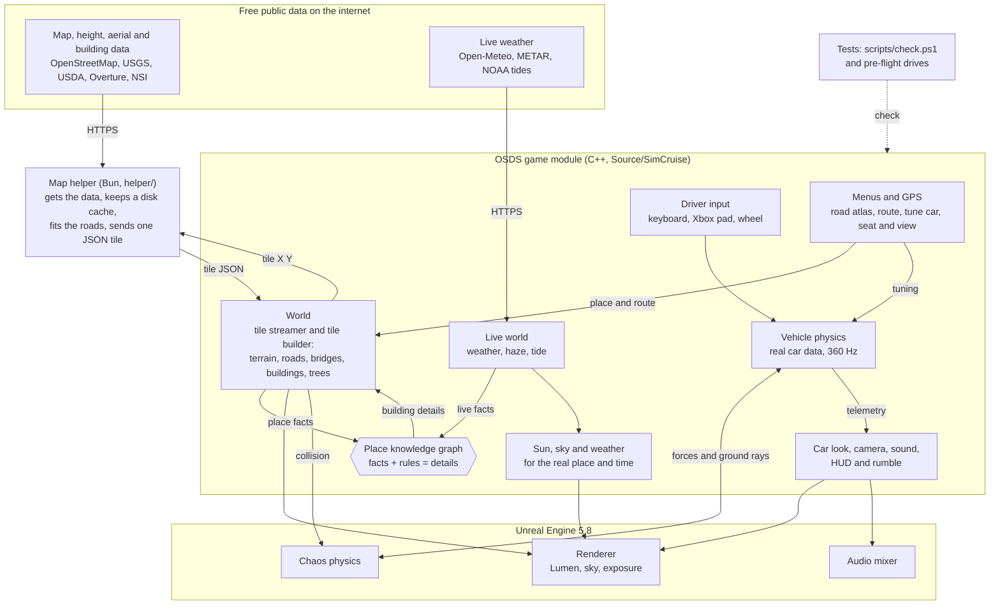

<p align="center">
  <picture>
    <source media="(prefers-color-scheme: dark)" srcset="docs/brand/png/osds-lockup-full-white.png">
    
  </picture>
</p>

<p align="center">
  <b>OSDS, the Open Source Driving Simulator: free driving on real roads.</b><br>
  Type any US address and drive there. The roads, terrain, buildings and trees are built live from OpenStreetMap, USGS elevation data and aerial photographs.<br>
  Realistic car physics and a GPS. Keyboard, Xbox controller or USB wheel. Made in Unreal Engine 5, for Windows.
</p>

<p align="center">
  <a href="https://github.com/simcruisegame/simcruise/releases/latest"><b>Download for Windows (free)</b></a>
  · <a href="https://simcruisegame.github.io/simcruise/">Website</a>
  · <a href="#screenshots">Screenshots</a>
  · <a href="#famous-roads-to-drive">Famous roads</a>
  · <a href="docs/controls.md">Controls</a>
  · <a href="docs/technical-deep-dive.md">How it works</a>
  · <a href="#questions">Questions</a>
</p>

<p align="center">
  <a href="https://github.com/simcruisegame/simcruise/releases/latest"></a>
  <a href="https://github.com/simcruisegame/simcruise/releases"></a>
  <a href="LICENSE"></a>
  <a href="https://www.unrealengine.com/"></a>
</p>

<p align="center">
  
</p>

---

## Project status

The game is currently in its first phase of development, and all contributions are appreciated. See [Contributing](#contributing) to help.

## About

OSDS (Open Source Driving Simulator) puts you behind the wheel anywhere in the United States. Roads, terrain, buildings and trees are generated on the fly from open public data (OpenStreetMap, USGS, USDA, NOAA, NASA, Overture and more), and every car is physically modelled and calibrated against published road-test numbers: the 1999 Mazda MX-5 Miata it started with, a 1965 Ford Mustang 289, a Corvette Stingray (C8) and four more.

No account, no API keys, no subscription, no telemetry. The game downloads open data for the place you drive and keeps it in a cache on your disk. It is careful with the public servers that give this data: see [Data and the public servers](#data-and-the-public-servers).

> **OSDS moved to Unreal Engine 5.8 in November 2026.** The Godot client that made the 1.x releases is kept at the git tag [`godot-final`](https://github.com/simcruisegame/simcruise/tree/godot-final) (`git show godot-final:game/<file>`); everything below is about the Unreal client. The Unreal client goes anywhere in the US again: a normal start is a random road from the start pool, `/` searches for a place, and Tab (Menu on the pad) opens the pause menu, whose Drive page has the road atlas to drive anywhere on the map. Trees, rangeland scrub, the land to the horizon, guard rails, bridges, gravel roads and traffic signals are built for wherever you are. What is still being ported is in [the migration ledger](docs/unreal-migration-ledger.md).

## Download

**OSDS 2.0.3 for Windows** (64-bit Windows 10 or 11, DirectX 12): get `SimCruise-2.0.3-windows-x64-setup.exe` from the [latest release](https://github.com/simcruisegame/simcruise/releases/latest), run it, and start it from the Start menu (releases up to 2.0.3 use the old name, SimCruise, for their files and the Start menu entry). The installer also installs the two Microsoft parts that the game needs if your PC does not have them: the Visual C++ 2015-2022 runtime (x64) and GameInput. A portable zip and SHA-256 checksums are on the same page. Install steps and system requirements: [docs/install.md](docs/install.md). Controls (keyboard, Xbox controller, USB wheel): [docs/controls.md](docs/controls.md).

**New in 2.0.3:**

- **A world that looks more real.** Trees take the colour of their own crown in the aerial photograph, with rounded light and a darker inside. Building walls are brick, lap siding, concrete block, stone, concrete panels or metal, from the map data or from what is usual for the region and the building type. Windows follow the wall (fewer on side and back walls, pairs on houses), and each building has a door on its main street side. The ground takes the real colours of the place's grass, soil, sand and paving from its aerial photograph.
- **Cars that drive more like the real ones.** Each wheel knows its surface (asphalt, concrete, gravel, grass, kerb). Engines without a turbo lose power in thin air. The automatic gearbox shifts by road speed and changes up at the limiter. The clutch slips only when you pull away. Traction control sees a wheel that spins in the air.
- **Everything with the Xbox controller.** Every menu works with the pad alone, with a pad keyboard for search, button hints that follow the device you used last, and a quit question. The rumble lets you feel the road: each surface, kerbs on their own side, the ABS pulse and the slip of the tyres.
- **About 2 ms of GPU time back on the Ultra preset**, cheaper mirrors, and sharper HUD digits.
- **No traffic and no aircraft for now.** The work goes into the world and the driving. Parked cars stay.
- **An installer that works on a clean PC**, with the Microsoft runtimes.

Everything, with the known issues: [CHANGELOG.md](CHANGELOG.md) and [Known issues in 2.0.3](#known-issues-in-203).

Tested on one laptop with an RTX 2070 Super Max-Q (Windows 11, 32 GB): the game caps the frame rate at 60 fps, and about 50 ms goes from the stick to the picture (measured for 2.0.1). At the Ultra preset at 1080p and a fixed 75 % resolution the GPU needs a median of 18.5 ms a frame on the Tail of the Dragon and 19.6 ms on Ocean Drive, so Ultra on that laptop GPU uses dynamic resolution to keep the frame rate. The release gates are in [docs/release/](docs/release/).

## Famous roads to drive

Open the pause menu (Tab, or Menu on the pad) and choose **Famous roads**. The GPS takes you from the start to the end of the road:

| Road | What it is | Length |
|---|---|---|
| **Tail of the Dragon, US 129** (North Carolina and Tennessee) | 318 curves in 11 miles, from Deals Gap to the Tabcat Creek bridge | 10.8 mi |
| **Big Sur, California 1** (Pacific Coast Highway) | Cliffs over the Pacific, from Bixby Creek Bridge to Big Sur | 13.2 mi |
| **Monument Valley, US 163** (Utah) | The straight road to the buttes, from Forrest Gump Point | 6.2 mi |
| **Ocean Drive, Miami Beach** (Florida) | Art Deco hotels and the beach, from Lummus Park to Collins Park | 1.3 mi |

The team also tests each release on these roads and on a rural road in Nebraska, and at random US places, because the game must work everywhere, not only on famous roads.

These are only a start. Press / to search for any other US place (your own street, a mountain pass, a city you want to see) and drive the real roads there.

## Screenshots

From the 2.0.2 Shipping build, Ultra preset, 1920x1080.


*The GPS on Ocean Drive: the turn sign at the top, the speed and gear at the bottom left, the round map with the route and the arrival time at the bottom right.*

| | |
|---|---|
|  |  |
| *The pause menu (Menu or Tab)* | *Plan a route* |
|  |  |
| *Seat & view* | *Tune car* |
|  |  |
| *2001 Miata, Tail of the Dragon* | *Corvette Stingray (C8), Big Sur* |
|  |  |
| *Corvette cockpit, Big Sur* | *Hood view, 1965 Mustang* |
|  |  |
| *Far chase view, Ocean Drive* | *Ocean Drive at night (2.0.1)* |

*Captured with `-SimCruiseUiShots` and `-SimCruiseDriveCapture` (see [docs/unreal-building.md](docs/unreal-building.md#drive-captures)). Map data © OpenStreetMap contributors. The 2.0.1 screenshots are in [docs/images/release-2.0.1/](docs/images/release-2.0.1/), earlier ones in [docs/images/unreal/](docs/images/unreal/).*

## Features

- **Real places from public data.** Roads, terrain, buildings, land cover and water come from OpenStreetMap, USGS, USDA and Overture through the keyless map helper, streamed in tiles around the car with a floating origin.
- **Buildings and trees from the place.** Each building's walls, windows, door and steps follow its mapped material, its use and its region. Each tree stands where the canopy height map shows a crown, at its measured height, width and shape, in the colour of its crown in the aerial photograph.
- **A place knowledge graph.** Facts about the place (climate, region, building style, use, era) and rules decide the details of each building, the same way for any US place. The team's next step is "calibrated imagination": the AI fills in details only where no data measures them, as a probability with a source, and never against a measurement ([technical deep dive](docs/technical-deep-dive.md#9-the-place-knowledge-graph)).
- **Cars that drive like the real ones.** The physics runs on Chaos at a fixed 360 Hz with every wheel's contact, tyre slip, suspension, engine, clutch, gearbox and differential from published specifications, held to magazine 0–60 mph, 70–0 mph and skidpad figures by automated benches. The automatic changes gear with the pedal, as a real one does.
- **Roads built like real roads.** Fitted ribbons with crown and curbs, MUTCD markings, parking lanes with parked cars and crosswalks, street lights behind the curbs.
- **No moving traffic and no aircraft in 2.0.3.** They are removed for now, so that the work goes into the world and the driving. Parked cars stay. The code stays in the repository behind `sc.Feature.Traffic` and `sc.Feature.Planes` (0 by default) for development.
- **An engine and a road you hear.** A procedural inline-four voice follows the simulated crank: firing pulses, load, intake, the limiter's stutter and overrun pops; tyre hiss, gravel crunch, scrub and squeal from each tyre's slip, and a little wind, all darker from the driver's seat. Live rear-view and door mirrors show the road behind.
- **The real sun and sky.** Sun and moon where they are at that place and time, physically based sky and exposure in real units, street lights and lit windows at night, low beams with a real cut-off. A drive starts in a morning sun; `-SimCruiseRealTime` follows your clock instead.
- **The real place, now.** While you drive, the game reads free public live feeds for the place you are: the weather (Open-Meteo and the nearest airport's METAR) sets the clouds, haze, mist and wet roads; the air quality (aerosol optical depth) sets the haze in clear air; the sea and the nearest NOAA tide gauge give the tide and waves. `-SimCruiseNoLive` turns it off.
- **AI made for the world.** The fine-detail textures of the ground and the road (asphalt, concrete, soil, sand, leaf litter and more) were made offline with Stable Diffusion XL. Two local models run on your own CPU through Unreal's Neural Network Engine, with no cloud: Real-ESRGAN adds detail to the aerial photographs once for each place, and our aerial eye reads each tile's photograph into surface classes for the next steps of the world ([details](docs/technical-deep-dive.md#10-local-ai)).
- **Keyboard, Xbox controller or USB wheel**, with steering and pedal shaping that never fakes the physics, rumble from tyre slip, the road surface, kerbs and the ABS, every menu usable with the pad alone, a clutch on the right thumb and gears on the bumpers, a tuning menu (springs, dampers, ride height, anti-roll bars, gearing, steering ratio) and a seat & view menu, both in the road atlas and usable with the pad, seat, hood, near and far chase cameras with look-around on the right stick, traffic on, light or off, and a natural driver's lens or the true field of view of your screen (F6 or the atlas; screen size and eye distance on the road atlas).
- **Open data, open code.** Every data source is free and keyless, and its licence is recorded in [`licenses/`](licenses/) and [CREDITS.md](CREDITS.md).

## How the game works

OSDS is a C++ game module on top of Unreal Engine 5.8, and a separate map helper program. Unreal gives the renderer, the Chaos physics solver, the audio mixer and the input system. The OSDS code makes the world, the cars and the menus. The diagram shows the main parts and how data moves between them. The [technical deep dive](docs/technical-deep-dive.md) has a diagram of all working parts and tells how each part operates.



How one frame of a drive works:

1. The tile streamer finds the map tiles near the car, and the tiles on the line to where the car will be at its speed. For each tile that is not loaded, it asks the map helper.
2. The map helper gets the public data (or reads it from the disk cache), fits the roads to the ground, and sends back one JSON tile.
3. The tile builder makes the terrain, roads, bridges, buildings, trees and road furniture on worker threads. It adds one tile to the world in each frame.
4. The place knowledge graph uses facts about the place (for example "Art Deco", "hotel", "humid subtropical climate", "night", "rain") and its rules to choose the details of each building: wall material, colours, windows, door.
5. The live world reads the weather feeds. The clouds, haze, rain and tide go into the sky, the sea and the knowledge graph.
6. Your input goes to the vehicle physics. The physics runs 360 times each second on the Chaos physics thread. It calculates each tyre, spring, the engine, the gearbox and the differentials from the real car's data.
7. The telemetry from the physics moves the car model, the wheels, the gauges, the camera, the engine sound, the HUD and the rumble.
8. Unreal renders the picture and mixes the sound.

The automated tests (`scripts/check.ps1`) and the pre-flight drives check the physics against real road-test numbers and check the world before each release. More detail is in [docs/technical-deep-dive.md](docs/technical-deep-dive.md), [docs/technical-overview.md](docs/technical-overview.md) and [docs/unreal-architecture.md](docs/unreal-architecture.md).

## Data and the public servers

OSDS uses only free, keyless public data. Many of these servers are run by volunteers or by public agencies, so the game must not overload them when many people play.

- The map helper keeps everything it downloads in a cache on your disk, and asks a server again only when the data is old.
- It sends at most two requests at the same time to each server. When a server fails, the helper waits 15 s, then longer and longer, up to 6 hours.
- In 2.0.3 a normal drive does not ask the volunteer Overpass, Wikidata and Wikipedia servers, and it does not ask adsb.lol (no aircraft). The game uses facts that are in the installer and its own rules instead.
- Every request carries one generic name for the game and its version, and no personal data.
- **Planned:** per-state data packs. The data for each US state is made once and put on a static file host, and the game reads only the parts it needs. Then a drive does not call the runtime services of the community servers at all.

The full list of what the game downloads, and from where, is in [the technical deep dive](docs/technical-deep-dive.md#19-data-the-network-and-the-public-servers) and [docs/data-sources.md](docs/data-sources.md).

## Known issues in 2.0.3

- At some motorway interchanges a bridge meets the road below at the same level, instead of passing over it with real clearance. Real bridge clearance comes in 2.0.4.
- At about 300 short spots the ground stands 0.1 m to 1.4 m over the edge of a lane, mostly at tile borders and junctions.
- On a hard launch the 1965 Mustang and the Corvette can stay at the fuel cut in 1st gear with the rear tyres slipping. A fix is ready for 2.0.4.
- The Corvette's automatic gearbox can change from 1st directly to 3rd.
- Small lips (about 6-12 cm) where some driveways and ramps join a road.
- In direct sun, dark jagged shadow marks can show on the Miata's dash behind the steering wheel.

The details are in [CHANGELOG.md](CHANGELOG.md) and [the technical deep dive](docs/technical-deep-dive.md#24-known-faults-in-203).

## Running it

**Windows:** install with the setup from [Releases](https://github.com/simcruisegame/simcruise/releases) (see [Download](#download)). macOS follows when a Mac is available to build on. From source on Windows:

1. Install Unreal Engine 5.8, Visual Studio 2022 Build Tools with the C++ game workload, and [Bun](https://bun.com/) (for the map helper).
2. Clone the repository and build the editor target (PowerShell, editor closed):

   ```powershell
   & 'C:\Program Files\Epic Games\UE_5.8\Engine\Build\BatchFiles\Build.bat' SimCruiseEditor Win64 Development -Project="$PWD\SimCruise.uproject" -WaitMutex
   ```

3. Drive:

   ```powershell
   & 'C:\Program Files\Epic Games\UE_5.8\Engine\Binaries\Win64\UnrealEditor.exe' "$PWD\SimCruise.uproject" -game
   ```

The game starts on a random US road from the start pool (it needs the network; offline it falls back to the bundled Ocean Drive streets) and puts you in the lowered 2001 Miata. Press / to search for a place, or Tab for the pause menu: plan a GPS route, pick a famous road, or open the road atlas. `-SimCruiseBundledStart` always starts on Ocean Drive. To make a standalone Windows build instead (no editor needed to play it), run `powershell -ExecutionPolicy Bypass -File scripts\package.ps1` and start `Saved\Package\Windows\SimCruise.exe`; `scripts\release.ps1` makes the installer too ([release checklist](docs/release/RELEASE-CHECKLIST.md)). Options (another car, a fixed time, graphics presets, captures) are in [docs/unreal-building.md](docs/unreal-building.md#drive-it).

| Action | Keyboard | Xbox controller |
|---|---|---|
| Accelerate / brake | W / S | Right / left trigger |
| Steer | A / D | Left stick |
| Camera | C | Y |
| Automatic / manual gearbox | T | Right-stick click |
| Recover to the road | R | View |
| Pause menu (route, places, car, view, settings) | Tab | Menu |
| Menu pages | Q / E | LB / RB |
| Plan a route: move, add stop, remove, start, zoom | Arrows or drag, Enter or click, Delete, Y, - / + | Left stick, A, X, Y, LT / RT |

Every control is in [docs/controls.md](docs/controls.md).

To build and run the automated tests (vehicle benches, world, traffic, audio, presentation, drive), with the editor closed:

```powershell
powershell -ExecutionPolicy Bypass -File scripts\check.ps1
sh scripts/check-helper.sh   # map helper tests
```

It prints each failure with its first errors and `CHECKS PASSED` or `CHECKS FAILED`, and exits 0 or 1; `-Filter SimCruise.Vehicle` runs a part, `-NoBuild` skips the build.

## Repository layout

| Folder | Contents |
|---|---|
| `Source/SimCruise/` | The Unreal client (C++): vehicle physics, world streaming, car presentation, lighting, driving shell, tests |
| `Config/`, `Content/` | Unreal project settings; car presentation profiles and calibration overlays |
| `data/` | Engine-neutral data the client reads: `cars/` (car physics JSON), `art/traffic/` (glTF car models and their manifest), `art/ground/` (detail photographs), `tiles/` (the bundled offline start and its aerial photographs), `observed/` (helper fixtures) |
| `helper/` | The map helper (Bun): fetches and converts public data into tiles |
| `scripts/` | Build, test, package and release scripts (PowerShell) |
| `packaging/` | The Windows installer (Inno Setup) |
| `lab/` | Research tools and experiments (Python and JavaScript), not part of the game |
| `licenses/` | The licence text of each data source, model and library |
| `docs/` | Architecture, building, cars, research, the migration ledger |

## Questions

**Is OSDS free?** Yes. The game is free and open source (the code is under the MIT License). There is no account, no API key, no subscription, no ads and no telemetry.

**What do I need to play?** 64-bit Windows 10 or 11, a DirectX 12 graphics card with 6 GB of video memory (for example an NVIDIA GTX 1660 or AMD RX 5600), 16 GB of memory, 3 GB of disk and an internet connection for all places except the bundled Ocean Drive, Miami Beach. The installer installs the Microsoft parts that the game needs (Visual C++ runtime, GameInput). We tested on one PC only (RTX 2070 Super Max-Q, Windows 11); the full list is in [docs/install.md](docs/install.md#system-requirements). There is no macOS or Linux build of the Unreal client yet.

**Can I drive my own street?** Yes, if it is in the United States. Press / and type the address or the place name. The game builds the roads, terrain, buildings and trees there from public data. The detail depends on how well OpenStreetMap maps that place. Places outside the United States are not supported yet.

**Is it a racing game?** No. OSDS is a driving simulator: you drive real roads with realistic car physics and a GPS. It has no races or opponents.

**Is there traffic?** Not in 2.0.3. Moving traffic and aircraft are removed for now, so that the work goes into the world and the driving. Parked cars stay.

**Can I use a steering wheel?** Yes. A USB wheel with a Windows GameInput driver, an Xbox controller and the keyboard all work. See [docs/controls.md](docs/controls.md).

**Which cars are there?** The 1999 and 2001 Mazda MX-5 Miata, the 1965 Ford Mustang 289, the Corvette Stingray (C8) and more. Each car is calibrated against published road-test numbers (0–60 mph, 70–0 mph braking and skidpad). See [docs/cars.md](docs/cars.md).

**Can I build it or change it?** Yes. The full C++ source of this open-source Unreal Engine driving simulator is in this repository. Build it with Unreal Engine 5.8 as described in [Running it](#running-it), and read [CONTRIBUTING.md](CONTRIBUTING.md) before you send a pull request.

## Contributing

Contributions are welcome: code, data sources, bug reports from places that look wrong, and documentation. Please read [CONTRIBUTING.md](CONTRIBUTING.md) first. The short version: no keys or paid services, only freely licensed assets, and every change comes with a measurement.

- Report bugs and request features in [Issues](https://github.com/simcruisegame/simcruise/issues).
- See the [roadmap](docs/roadmap.md) for what is planned.
- Report security problems privately, as described in [SECURITY.md](SECURITY.md).
- Everyone taking part follows the [Code of Conduct](CODE_OF_CONDUCT.md).

## Documentation

| Document | Contents |
|---|---|
| [Technical deep dive](docs/technical-deep-dive.md) | A diagram of all working parts, and how each part operates (2.0.3) |
| [Technical overview](docs/technical-overview.md) | The Unreal client, the helper, tile streaming, the car model, rendering, privacy |
| [How the game works, for the team](docs/team/how-the-game-works.md) | One page for each role: the parts, where the code is, one launch from start to drive |
| [Install](docs/install.md) | System requirements, the installer, the Microsoft parts, where the game keeps its files |
| [Unreal architecture](docs/unreal-architecture.md) | Every subsystem of the Unreal client in detail, with what it looks like and what is missing |
| [Building with Unreal](docs/unreal-building.md) | Build, run, options, captures, tests |
| [Migration ledger](docs/unreal-migration-ledger.md) | Every Godot file and check, where it went in Unreal, and its status |
| [Data sources and licences](docs/data-sources.md) | Every data layer, its source and licence |
| [Controls](docs/controls.md) | Full control reference, manual gearbox, road atlas |
| [Place knowledge graph](docs/place-graph.md) | How facts and rules decide the details of each building, and the live-data hub |
| [Cars](docs/cars.md) | The garage, how cars are calibrated, adding a car |
| [Roadmap](docs/roadmap.md) | What comes next and why |
| [Changelog](CHANGELOG.md) | Changes by version |
| [Studies](docs/studies.md) | Research notes behind individual features |
| [Taste test](lab/taste/2026-11-10/README.md) | The game rendered at the pose of licensed photographs, with ranked differences for the car and the place |
| [Related projects](docs/related-projects.md) | Similar games and tools |

## License

The game code, shaders, map helper and tests are released under the [MIT License](LICENSE). Map data, imagery, models, textures and fonts keep their own licences, listed in [CREDITS.md](CREDITS.md), [docs/data-sources.md](docs/data-sources.md), [`licenses/`](licenses/) and [Credits.txt](Credits.txt). Map data © OpenStreetMap contributors.

OSDS was called *SimCruise* from version 1.1 to 2.0.3 (until November 2026), and *Sunday Driver* up to version 1.0.8; older notes still use those names. The code keeps the SimCruise name inside (the `Source/SimCruise` module, `SimCruise.uproject`, the `-SimCruise...` command-line options and the `%LOCALAPPDATA%\SimCruise` settings folder), so old saves, settings and scripts keep working. The logo and brand rules are in [docs/brand/](docs/brand/README.md).

## Credits

OSDS is built on the work of many makers. Thank you to each of them. The full list, with every licence and link, is in **[CREDITS.md](CREDITS.md)**.

- **Map data** © [OpenStreetMap](https://www.openstreetmap.org/copyright) contributors (ODbL), served by [OpenFreeMap](https://openfreemap.org/) with the [OpenMapTiles](https://openmaptiles.org/) schema. Place search by [Photon](https://photon.komoot.io/) (komoot). Buildings also from the [Overture Maps Foundation](https://overturemaps.org/), with Microsoft and Esri Community Maps footprints, and building use from the U.S. Army Corps of Engineers National Structure Inventory (public domain).
- **Elevation, aerial photographs and land cover** from USGS (3D Elevation Program, The National Map), USDA (NAIP), LANDFIRE and MRLC (NLCD), Mapzen, NASA and Copernicus Sentinel-2. Tree heights from [Version 2 High Resolution Canopy Height Maps (CHMv2)](https://registry.opendata.aws/dataforgood-fb-forestsv2/) by Meta and the World Resources Institute (WRI), 2026, source imagery © 2016 Vantor ([CC BY 4.0](https://creativecommons.org/licenses/by/4.0/)); the game derives tree positions, crown sizes and crown shapes from it (changed).
- **Climate:** Köppen-Geiger 1991-2020 classes by Beck et al. (2023), CC BY 4.0.
- **Live data:** weather data by [Open-Meteo.com](https://open-meteo.com/) (CC BY 4.0), and NOAA weather and tides. (The aircraft feed from adsb.lol is not used in 2.0.3.)
- **AI models:** [Stable Diffusion XL](https://huggingface.co/stabilityai/stable-diffusion-xl-base-1.0) by Stability AI (CreativeML Open RAIL++-M, for the fine-detail textures), [Real-ESRGAN](https://github.com/xinntao/Real-ESRGAN) by Xintao Wang and others (BSD 3-Clause), our aerial eye with the first stages of [SatlasPretrain](https://github.com/allenai/satlaspretrain_models) by the Allen Institute for AI (ODC-BY), [Detectron2](https://github.com/facebookresearch/detectron2) by Meta AI Research (a development tool; weights CC BY-SA 3.0), and, planned, [DeepForest](https://github.com/weecology/DeepForest) by the Weecology lab (MIT). Qualcomm AI Hub made the ONNX files of Real-ESRGAN and Detectron2. The models run with [ONNX Runtime](https://github.com/microsoft/onnxruntime) (Microsoft, MIT).
- **Cars:** Sketchfab models under CC BY 4.0, among them "Mazda MX-5 (NB) convertible HQ interior" by [niev](https://sketchfab.com/niev), the 1965 Mustang by Kristian LaGrange and the Corvette C8 by Hari Prasath R. **Textures and sky:** Poly Haven, Innerscene and OpenGameArt (CC0). **Font:** Overpass by Delve Withrington for Red Hat (SIL OFL 1.1).
- **Engine and tools:** [Unreal Engine](https://www.unrealengine.com/) by Epic Games and [Bun](https://bun.com/), with the open-source libraries listed in [CREDITS.md](CREDITS.md#engine-libraries-and-tools).

The state, county and city sources and the photographers used for single places are named in [Credits.txt](Credits.txt).
