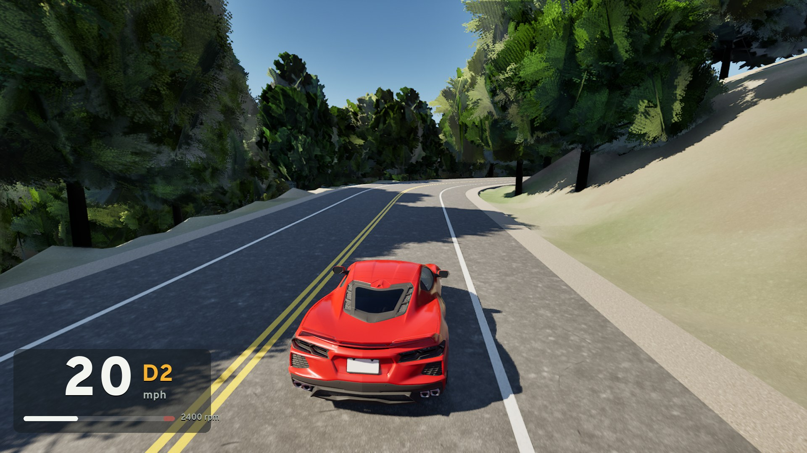
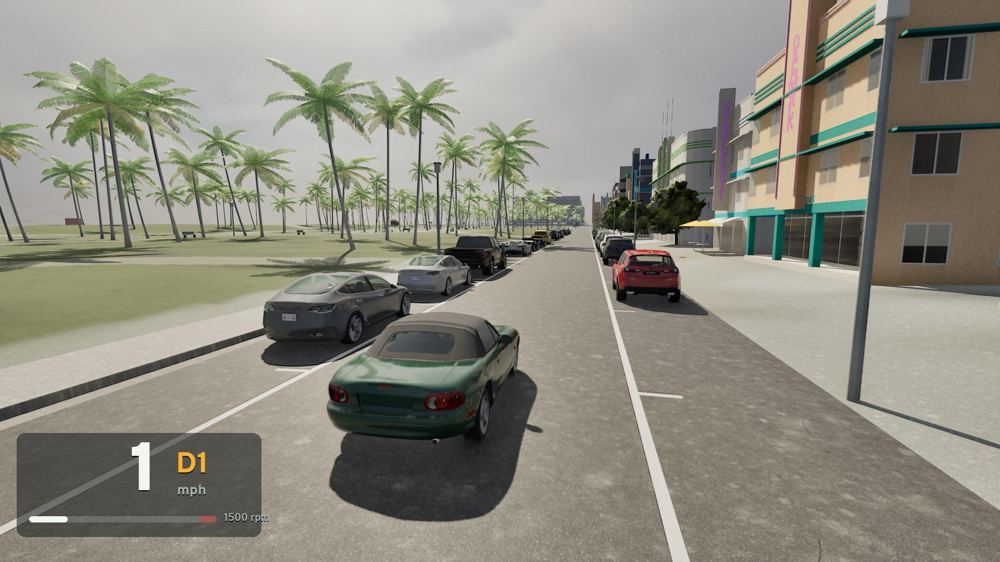
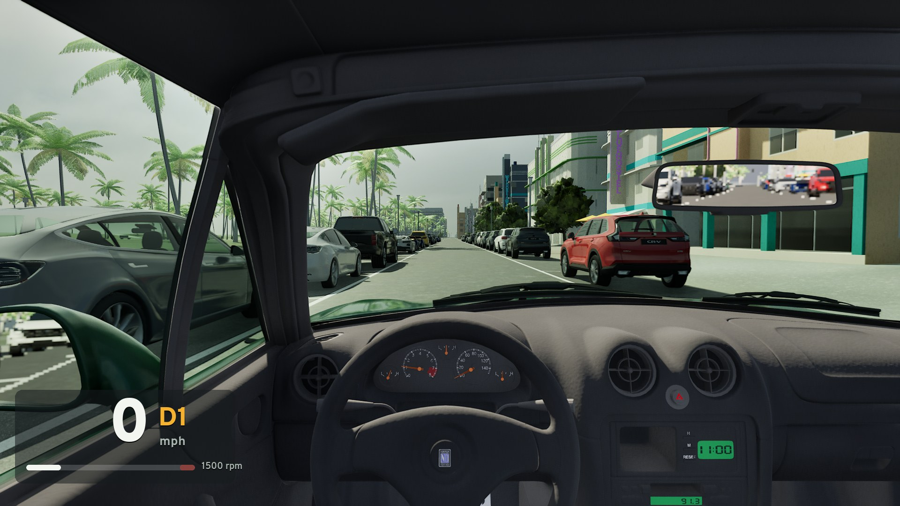
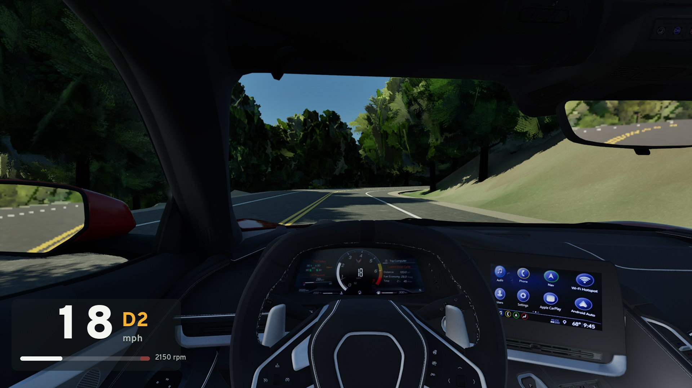
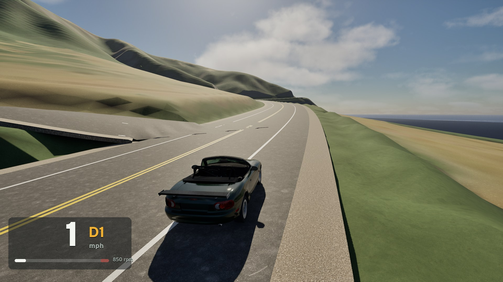
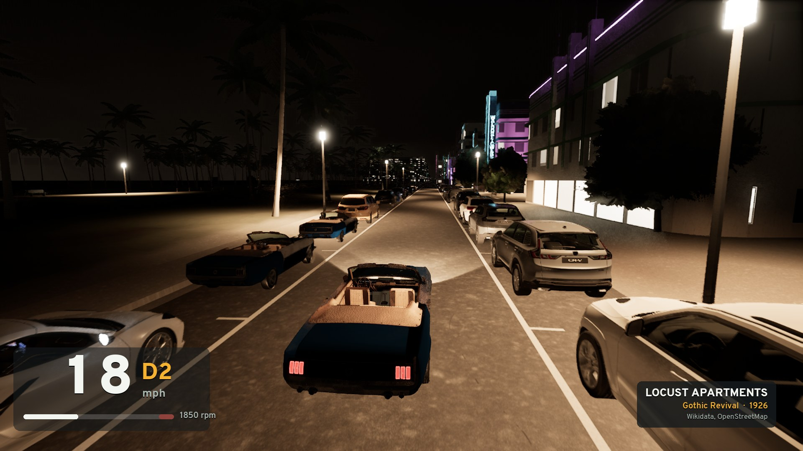
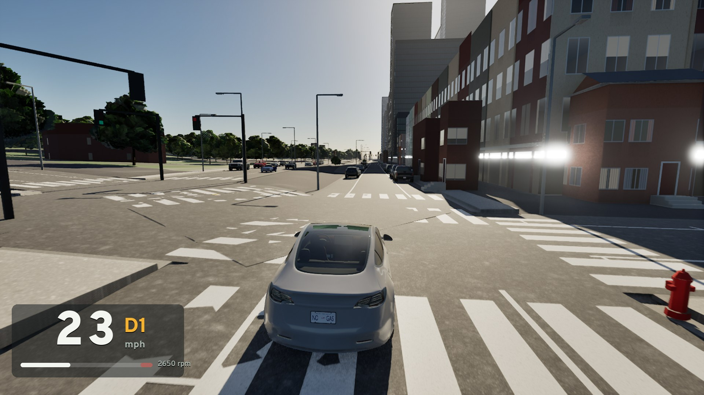

<p align="center">
  <picture>
    <source media="(prefers-color-scheme: dark)" srcset="docs/brand/png/osds-lockup-full-white.png">
    
  </picture>
</p>

<p align="center">
  <b>Drive any real road in the US.</b> Free, open source, Unreal Engine 5, Windows.<br>
  Roads, terrain, buildings and trees are built live from OpenStreetMap, USGS elevation and aerial photos.<br>
  Cars are calibrated against real road tests. Keyboard, Xbox controller or USB wheel.
</p>

<p align="center">
  <a href="https://github.com/simcruisegame/simcruise/releases/latest"><b>Download for Windows</b></a>
  · <a href="https://simcruisegame.github.io/simcruise/">Website</a>
  · <a href="docs/controls.md">Controls</a>
  · <a href="CHANGELOG.md">What's new</a>
  · <a href="docs/technical-deep-dive.md">How it works</a>
</p>

<p align="center">
  <a href="https://github.com/simcruisegame/simcruise/releases/latest"></a>
  <a href="https://github.com/simcruisegame/simcruise/releases"></a>
  <a href="LICENSE"></a>
  <a href="https://www.unrealengine.com/"></a>
</p>

<p align="center">
  
</p>

## TL;DR

- **Download** the setup from [Releases](https://github.com/simcruisegame/simcruise/releases/latest), install, play. Windows 10/11, DirectX 12 GPU with 6 GB, 16 GB RAM, internet ([details](docs/install.md)).
- **Drive anywhere:** press `/` and type a US place. Tab (Menu on the pad) opens the pause menu: GPS route, famous roads, car, view, settings.
- **No account, no keys, no telemetry.** Only free public data, cached on your disk.
- **Early days.** It is a driving simulator, not a racing game. No moving traffic for now. See [known issues](#known-issues).

## Famous roads

Pause menu > **Famous roads**, and the GPS takes you along:

| Road | Length |
|---|---|
| Tail of the Dragon, US 129 (NC/TN): 318 curves | 10.8 mi |
| Big Sur, CA 1: Bixby Creek Bridge to Big Sur | 13.2 mi |
| Monument Valley, US 163 (UT) | 6.2 mi |
| Ocean Drive, Miami Beach (works offline) | 1.3 mi |

## Controls

| Action | Keyboard | Xbox controller |
|---|---|---|
| Throttle / brake | W / S | Right / left trigger |
| Steer | A / D | Left stick |
| Shift up / down (manual; automatic clutch by default) | E / Q | RB / LB |
| Automatic / manual | T | Right-stick click |
| Camera | C | Y |
| Back on the road | R | View |
| Pause menu | Tab | Menu |

Everything else, including stability control (ESC): [docs/controls.md](docs/controls.md).

## Screenshots

| | |
|---|---|
|  |  |
| *Miata, Ocean Drive* | *Miata cockpit* |
|  |  |
| *Corvette cockpit, Tail of the Dragon* | *Miata, Big Sur* |
|  |  |
| *Mustang, Ocean Drive at night* | *Model 3, Chicago* |

More in [docs/images/](docs/images/).

## Known issues

- Small lips (6-12 cm) where some driveways and ramps join a road.
- Very long bridges (the 8 km Mackinac Bridge) can still throw the car at a map-tile border.
- Stacked motorway interchanges (the High Five in Dallas) may show steps between levels.
- In direct sun, dark jagged shadow marks can show on the Miata's dash behind the steering wheel.
- Full list per release: [CHANGELOG.md](CHANGELOG.md).

## Build from source

Needs Unreal Engine 5.8, Visual Studio 2022 Build Tools (C++ game workload) and [Bun](https://bun.com/). In PowerShell, editor closed:

```powershell
& 'C:\Program Files\Epic Games\UE_5.8\Engine\Build\BatchFiles\Build.bat' SimCruiseEditor Win64 Development -Project="$PWD\SimCruise.uproject" -WaitMutex
& 'C:\Program Files\Epic Games\UE_5.8\Engine\Binaries\Win64\UnrealEditor.exe' "$PWD\SimCruise.uproject" -game
```

Tests: `powershell -ExecutionPolicy Bypass -File scripts\check.ps1` (add `-Filter SimCruise.Vehicle` for one part). Options, captures and packaging: [docs/unreal-building.md](docs/unreal-building.md).

| Folder | What |
|---|---|
| `Source/SimCruise/` | The game (C++): car physics, world, menus, tests |
| `helper/` | Map helper (Bun): turns public data into tiles |
| `data/` | Car data, car models, the bundled offline tiles |
| `scripts/` | Build, test, package, release |
| `docs/` | How it works, building, cars, research |

## Docs

For players: [Installing and PC needs](docs/install.md) · [Controls and menus](docs/controls.md) · [The cars](docs/cars.md) · [What's next (roadmap)](docs/roadmap.md)

For developers: [How the game works](docs/technical-deep-dive.md) · [How the code is organised](docs/unreal-architecture.md) · [Building from source](docs/unreal-building.md) · [Where the data comes from](docs/data-sources.md) · [Contributing](CONTRIBUTING.md) · [Security](SECURITY.md) · [Code of Conduct](CODE_OF_CONDUCT.md)

## License and credits

Code: [MIT](LICENSE). Data, imagery, models and fonts keep their own licences: [CREDITS.md](CREDITS.md), [docs/data-sources.md](docs/data-sources.md), [`licenses/`](licenses/), [Credits.txt](Credits.txt).

- Map data © [OpenStreetMap](https://www.openstreetmap.org/copyright) contributors (ODbL), via [OpenFreeMap](https://openfreemap.org/) / [OpenMapTiles](https://openmaptiles.org/); search by [Photon](https://photon.komoot.io/); buildings also from [Overture Maps](https://overturemaps.org/) and the USACE National Structure Inventory.
- Elevation, aerial photos and land cover: USGS (3DEP), USDA (NAIP), LANDFIRE, MRLC (NLCD), Mapzen, NASA, Copernicus Sentinel-2. Tree heights: [CHMv2](https://registry.opendata.aws/dataforgood-fb-forestsv2/) by Meta and WRI, 2026, imagery © 2016 Vantor ([CC BY 4.0](https://creativecommons.org/licenses/by/4.0/)), changed. Climate: Köppen-Geiger 1991-2020, Beck et al. (2023), CC BY 4.0. Weather: [Open-Meteo.com](https://open-meteo.com/) (CC BY 4.0) and NOAA.
- AI models: Stable Diffusion XL (textures), Real-ESRGAN, SatlasPretrain, Detectron2, run with ONNX Runtime ([details](CREDITS.md)).
- Cars: Sketchfab models under CC BY 4.0, among them the Mazda MX-5 (NB) by [niev](https://sketchfab.com/niev), the 1965 Mustang by Kristian LaGrange and the Corvette C8 by Hari Prasath R. Textures: Poly Haven, Innerscene, OpenGameArt (CC0). Font: Overpass (SIL OFL 1.1).
- Built with [Unreal Engine](https://www.unrealengine.com/) and [Bun](https://bun.com/).

OSDS was called SimCruise until 2.0.3; the code still uses that name inside (module, `-SimCruise...` options, `%LOCALAPPDATA%\SimCruise`), so old settings keep working.
