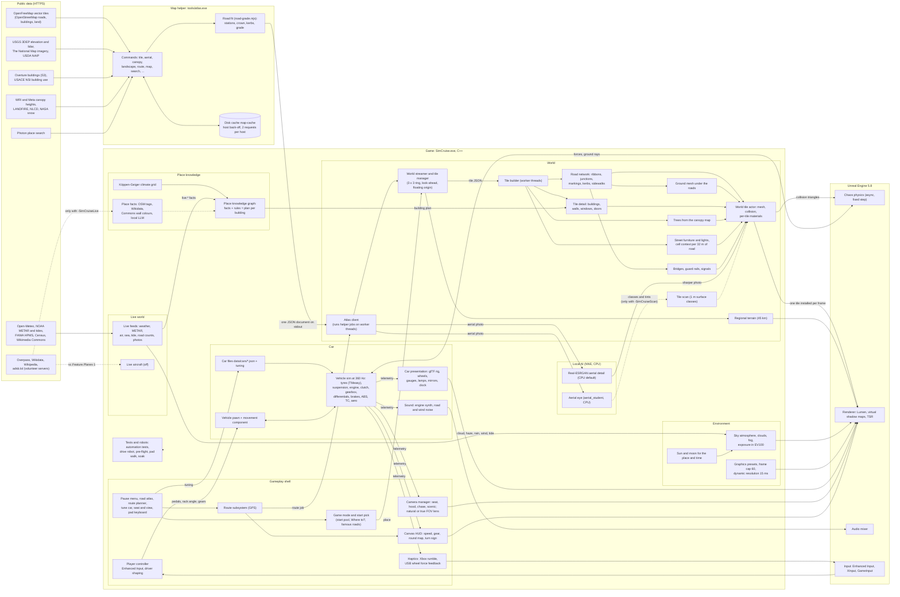

# Technical deep dive (version 2.0.3)

This document tells how every working part of OSDS operates, and how the parts connect. It is for people who want to read, change or check the code. It describes the code of the 2.0.3 release candidate. Where a part is in the code but is not on in a normal drive, this document says so.

For a short overview, read [technical-overview.md](technical-overview.md). For the detail of each Unreal subsystem, read [unreal-architecture.md](unreal-architecture.md). For the build and test commands, read [unreal-building.md](unreal-building.md).

## Contents

- [The diagram of all working parts](#the-diagram-of-all-working-parts)
- [The programs and the processes](#the-programs-and-the-processes)
- [Threads and timing](#threads-and-timing)
- [1. Start of a drive](#1-start-of-a-drive)
- [2. The map helper](#2-the-map-helper)
- [3. World streaming](#3-world-streaming)
- [4. The tile builder](#4-the-tile-builder)
- [5. Roads, bridges and civil structures](#5-roads-bridges-and-civil-structures)
- [6. Terrain and the land to the horizon](#6-terrain-and-the-land-to-the-horizon)
- [7. Buildings](#7-buildings)
- [8. Trees and vegetation](#8-trees-and-vegetation)
- [9. The place knowledge graph](#9-the-place-knowledge-graph)
- [10. Local AI](#10-local-ai)
- [11. Materials and the ground colour](#11-materials-and-the-ground-colour)
- [12. Sun, sky, weather and light](#12-sun-sky-weather-and-light)
- [13. Vehicle physics](#13-vehicle-physics)
- [14. The car you see](#14-the-car-you-see)
- [15. Driver input, cameras, rumble and the USB wheel](#15-driver-input-cameras-rumble-and-the-usb-wheel)
- [16. Menus, HUD and GPS](#16-menus-hud-and-gps)
- [17. Sound](#17-sound)
- [18. Graphics presets and GPU cost](#18-graphics-presets-and-gpu-cost)
- [19. Data, the network and the public servers](#19-data-the-network-and-the-public-servers)
- [20. Files on the player's PC](#20-files-on-the-players-pc)
- [21. Tests and checks](#21-tests-and-checks)
- [22. Packaging and the installer](#22-packaging-and-the-installer)
- [23. Parts that are off in 2.0.3](#23-parts-that-are-off-in-203)
- [24. Known faults in 2.0.3](#24-known-faults-in-203)

## The diagram of all working parts

The diagram shows each working part at the level of a module or a subsystem. Solid arrows show data in a normal drive. Dotted arrows show paths that are off by default in 2.0.3, or that are only for development and tests.

## The programs and the processes

OSDS has two programs:

| Program | Language | Where | What it does |
|---|---|---|---|
| The game, `SimCruise.exe` | C++ on Unreal Engine 5.8 | `Source/SimCruise/` (about 160 `.cpp` files, 10 modules) | Builds the world, simulates the car, draws the picture, plays the sound, reads the controls |
| The map helper, `tools/atlas.exe` | JavaScript, compiled to one executable by Bun | `helper/atlas.mjs` and 52 more modules | Gets the public map, height, aerial and building data, fits the roads, keeps a disk cache, and writes one JSON document for each request |

The game starts one helper process for each job (`<command> <cache dir> <args>`), on a worker thread. The helper writes one JSON document to stdout and stops. There is no server. Each job has a time limit. A time-out or a cancel stops the helper's process tree. An error, an empty answer or a bad answer is a typed error, not a crash (`Atlas/SimCruiseAtlasClient`).

The game modules in `Source/SimCruise/Private`:

| Module | Files | What it holds |
|---|---|---|
| `Atlas/` | Atlas client, User-Agent | Runs helper jobs; one generic User-Agent for every outside request |
| `World/` | Streamer, tile manager, tile builder, road network, tile detail, trees, bridges, guard rails, signals, street furniture, regional terrain, scan, start pick, road check, world resources | Everything that makes the place |
| `Knowledge/` | Place graph and its subsystem, place facts, place AI, place photos, roadside data, furniture data, climate | Facts about the place and the rules that turn facts into details |
| `Live/` | Live world subsystem, live data, live sky, neural detail, aerial eye, scene parser | Real-time feeds and the local AI models |
| `Environment/` | Solar position, daylight model, environment, weather, graphics presets, perf sampler, lighting lab | Sun, moon, sky, light units, exposure, presets |
| `Vehicle/` | Vehicle, movement component, vehicle sim, tyre, suspension and powertrain models, car file loader, tuning | The car physics |
| `Presentation/` | glTF reader, model rig, material library, presentation component, mirrors, clock, low beams, turntable | The car you see |
| `Gameplay/` | Game mode, player controller, driver shaping, cameras, HUD, haptics, pause menu, atlas UI, route planner, GPS, seat and tuning menus, theme, features, test robots | The driving shell and its tests |
| `Audio/` | Inline-four (and V8) synth, road noise synth, engine sound component | Procedural sound, no sample files |
| `Tests/` and `*/Tests/` | Automation tests | About 200 tests in groups `SimCruise.Vehicle`, `.World`, `.Gameplay`, `.Live`, `.Knowledge`, `.Environment`, `.UI`, `.Drive` and more |

## Threads and timing

| Thread | What runs on it | Rate |
|---|---|---|
| Game thread | Game mode, controller, menus, HUD, streamer bookkeeping, tile install (one tile each frame), live feeds, place graph hub | Each frame, capped at 60 fps (`simcruise.FrameCap`) |
| Physics thread (Chaos async) | The vehicle sim in a Chaos sim callback; it applies one force and one torque to the car body each step | Fixed 360 Hz (`AsyncFixedTimeStepSize=0.0027777778` in `Config/DefaultEngine.ini`), with wheel substeps |
| Worker threads | Helper jobs, tile builds (meshes, trees, furniture, buildings), car model build (glTF and rig) | When work is queued |
| AI threads | Aerial eye (at most 2 cores together with any other eye), Real-ESRGAN detail with a duty cycle | In the background; never on the game thread |
| Audio render thread | Engine, tyre, road and wind synths pull the latest state | 22.05 kHz buffers |
| Render thread and GPU | Unreal renderer | Each frame |

The game thread never waits for the network. A tile that is not ready is not drawn yet; the car stands on the tiles that are ready.

## 1. Start of a drive

`Gameplay/SimCruiseGameMode` chooses the start:

- A normal start is a random road from `data/start/start-pool.json` (36 roads).
- `/` (Where to?) searches for a place with the helper's `search` command (Photon).
- *Famous roads* in the pause menu goes to a hero road and sets a GPS route along it (`SimCruiseFamousRoads`).
- `-SimCruiseStart=lat,lon` starts at a point. `-SimCruiseBundledStart` starts on Ocean Drive.
- With no network, every start goes to the bundled Ocean Drive tiles in `data/tiles`.

The world subsystem starts the streamer at the place. The game mode waits until the tiles round the start are built and their collision is in the physics scene. A loading screen stays on the screen while it waits. Then `World/SimCruiseStartPick` finds a start by general rules: a public road, mid-block, 25 m or more inside its tile, a straight piece, in the traffic lane, with the car's footprint on the carriageway and no ground above the road, and 800 m or more of road ahead. The car model (glTF and rig) is built on a worker thread from the moment the drive starts, so the game thread does not freeze.

## 2. The map helper

The helper commands that a drive uses:

| Command | Answer |
|---|---|
| `tile x y` | One zoom-16 tile: heights, roads with fitted road surface stations, pedestrian ways, land and water, buildings (OpenFreeMap + Overture + NSI use), named places, street objects, lane counts |
| `aerial`, `aerial16` | The aerial photograph for a zoom-14 or zoom-16 tile (USGS The National Map; NAIP) |
| `canopy x y` | Single trees from the WRI and Meta canopy height map: one crown for each local height peak, with height, crown width and (`--segment`) crown shape |
| `landscape rx ry` | A simple mesh of USGS 3DEP elevation and photographs for the 90 km square round the car |
| `route` | A GPS route on the OpenStreetMap roads. The helper builds the road graph from the vector tiles and runs A* on the player's PC. There is no routing server |
| `map z x y` | A map tile for the road atlas and the route planner |
| `search` | Place search (Photon) |
| `forest-form`, `shrub-cover`, `ground-cover`, `snow`, `roofs`, `road-banks`, `lane-counts` | More layers (forest type, shrubs, land cover, snow, lidar roofs, road banks, lanes) |

The road fit (`helper/road-grade.mjs`) chains the road pieces, puts stations about every 2 m, and fits the ground under the centre line with a robust local fit, so a road has a smooth grade, a 2 % crown and kerbs where the map shows them.

The cache (`helper/atlas-cache.mjs`) keeps each answer on disk in `%LOCALAPPDATA%\SimCruise\map-cache` and trims it near 100 MB. It protects the public servers: at most two requests at the same time to each host (four for OpenFreeMap), and a host that fails is left alone for 15 s, then 30 s, and so on to 6 hours. A failed tile is tried again after 15 s, then a longer time, up to 15 minutes.

## 3. World streaming

`World/SimCruiseWorldStreamer` and `World/SimCruiseTileManager`:

- The world is Web Mercator zoom-16 tiles. A tile is 611.5 m × cos(latitude) across: about 550 m at Miami Beach, 418 m in North Dakota.
- The streamer keeps a ring of tiles round the car's tile (radius 1: 3 × 3 tiles), nearest first.
- At speed it loads the tiles on the line to where the car will be, at speed × (2 × the measured load time + 4 s). These tiles always keep one of the two load slots. At 130 km/h with 8 s loads, each tile is ready 4.4 s or more before the car arrives (`SimCruise.World.TileManager.HighwayLookAhead`).
- Tiles past the ring plus one tile are removed.
- Each job has a generation number. A new place makes a new generation, and old answers are not used.
- A floating origin keeps the car near (0, 0, 0). When the car moves far enough, the origin moves to the car's tile, and all tiles, the car and the cameras move by the same whole-tile offset.

## 4. The tile builder

`World/SimCruiseTileBuilder` turns one tile document into one build on a worker thread. `World/SimCruiseWorldTile` installs it on the game thread, one tile each frame.

Each tile is one procedural mesh with one section for each layer: terrain, asphalt, concrete, markings, water, buildings, props and foliage. Terrain, asphalt and concrete have collision ("complex as simple"), so the wheels touch the same triangles that the player sees. Trees and many props are instanced meshes.

The build order in a tile:

1. Roads: the road network (section 5).
2. The ground under and round the roads (section 6).
3. Bridges, guard rails, signals and street furniture.
4. Buildings from the building plan of the place graph (section 7).
5. Trees from the canopy map (section 8).
6. The tint of the ground classes from the aerial photo (section 11).
7. The road faces that the start pick needs.

`World/SimCruiseCellContext` makes one context record for each 32 m of road before any detail generator runs: what the roadside is (urban kerb, rural shoulder, ditch, fence, lamp rhythm). Palms, furniture, the grass field and the lamps read this record, so the generators agree with each other. Each cell has a seed from the OpenStreetMap way and its station, so the same place looks the same each time.

## 5. Roads, bridges and civil structures

`World/SimCruiseRoadNetwork`:

- Joins the road pieces through junctions, and rounds each mapped corner with an arc, so the ribbon follows the curve.
- Makes the carriageway, the crown, the kerbs, gutters and sidewalks, the MUTCD markings (centre lines, edge lines, lane lines, stop lines, crosswalks) and parking lanes.
- At a junction, a joining road takes the other road's height with a smooth fade, so there is no step.
- A rural road gets a shoulder, a 1:4 foreslope into a 0.45 m ditch, then a 1:1.5 cut or a 1:2 fill.

Civil structures:

| Structure | Code | 2.0.3 status |
|---|---|---|
| Bridges | `World/SimCruiseBridges`: a concrete deck 1.2 m deep, 0.85 m concrete parapets, piers every 35 m where the deck is more than 4 m over the ground | Mapped bridges have decks. At some motorway interchanges the deck meets the road below at the same level (see the known faults) |
| Guard rails | `World/SimCruiseGuardRails`: W-beam on posts every 1.905 m where the ground drops more than 3 m within 8 m of the shoulder (AASHTO) | On. Mapped guard rails from OpenStreetMap only with the helper flag `--mapped-guard-rails` |
| Traffic signals | `World/SimCruiseSignals`: where two through roads of collector class or higher cross | On |
| Tunnels, roundabouts, rail crossings | Roads on the map pass through; there is no special structure yet | Planned |

`World/SimCruiseRoadCheck` samples the road top every 0.1 m along each ribbon and finds steps. The ground is capped under every carriageway so that it does not stand over a lane (`World.TerrainNeverOverRoad`).

## 6. Terrain and the land to the horizon

- The driving ground is the helper's height grid for the tile (USGS 3DEP; Mapzen Terrarium tiles as a fallback), changed under the roads by the road fit.
- `World/SimCruiseRegionalTerrain` draws the land to 45 km round the car from the helper's `landscape` command: a simple mesh with a 512 px photograph over 90 km and a 1536 px photograph over the middle 13 km. It has no collision. Its material lowers it under the driving tiles near the camera and bends it with the Earth's curvature. A vertex far from the local median is replaced (no spikes from a bad elevation pixel).

## 7. Buildings

`World/SimCruiseTileDetail` builds each building from its footprint, height and use (OpenFreeMap, Overture, NSI) and from the plan that the place graph makes for it.

New in 2.0.3:

| Part | How it works |
|---|---|
| Wall material | The building shader draws brick coursing, lap siding, concrete block, ashlar stone, concrete panels or ribbed metal. The choice: first the building's mapped material; if there is none, the usual material for the region and the building type (siding on northern houses, brick in the South, stucco in the South-west and Florida, block and metal for warehouses) |
| Windows by wall | Street fronts have a window in each bay. Side and back walls have fewer. Houses have windows in pairs. Garages and metal sheds have almost none. Window rows use whole storeys only, with a plain band under the roof |
| Doors | One door on the main street side of each building, recessed, with a casing. Houses have a stoop and steps up to the floor; shops and offices a glass door and a step; garages a panel door |

Night: lit windows and neon come from the plan. Far towers keep their windows.

## 8. Trees and vegetation

`World/SimCruiseTrees`:

- Each tree stands where the canopy height map (WRI and Meta, CC BY 4.0) shows a crown. It takes that crown's height, width and shape (an ellipse fitted to 8 measured reaches).
- New in 2.0.3: each crown takes its colour from the aerial photograph at the crown, compared with the other crowns of the tile (so the photo's own exposure cancels), with a small change of hue and brightness for each tree. A crown is lit as one rounded mass and is darker inside. Bark is darker at the foot. `-SimCruiseOldTreeLook` turns this off.
- Broadleaf or conifer comes from rules by latitude and longitude. Palms grow where coconut palms grow.
- The grass, soil and rock of the ground come from the ground material (section 11). Steep ground shows rock from 30 degrees.

The next steps for trees (species from LANDFIRE in stands, shape variants, bushes from the canopy map, wind) are planned for 2.0.4 and later.

## 9. The place knowledge graph

`Knowledge/SimCruisePlaceGraph` and `data/knowledge/place-graph.json` decide which real details go where, for any US place.

- A **fact** is a token `kind:value` with a confidence from 0 to 1, for example `style:art_deco 0.9`, `climate:Cfa`, `poi:hotel`, `live:night`.
- Facts come from the tile data (height, footprint, named places), the region files in `data/knowledge`, the Köppen-Geiger climate grid (`data/climate`, Beck et al. 2023, CC BY 4.0), the live feeds, and (only with `-SimCruiseLive`) OpenStreetMap tags, Wikidata and the wall colour from a Commons photo of the building.
- **Rules** join facts into new facts with a weight, for example `style:art_deco -> detail:eyebrows 0.9, palette:deco_pastel 0.9`.
- The graph bakes one **plan** for each building on the tile build's worker thread (style, palette, wall material, roof form, details). The same input gives the same plan.
- `Knowledge/SimCruisePlaceAI`: where the open data says nothing, a small language model on the CPU (Ollama on `localhost`) reads the Wikipedia articles near the place and answers in the graph's own tokens. It runs only with `-SimCruiseLive` and when Ollama is installed.

**The direction: calibrated imagination.** The team's design for the next releases extends this graph into a world knowledge graph of real materials and objects. The method is: measure what the data can measure at the place; use statistics learned from places where open data counts things well; let the AI "imagine" only the parts that nothing measures, as a probability with a source; choose and adapt a library material for that part; and check the result against held-out real data. A guess never goes against a measurement. In 2.0.3 the graph uses rules that people wrote; the learned statistics are research work, not in the game yet.

## 10. Local AI

All models run on the player's own PC through Unreal's Neural Network Engine (ONNX Runtime). No model sends data to a server. No model runs on the game thread.

**What ships:** the package includes only the model files on the allow-list in `scripts/ShippedModels.ps1`: `real-esrgan-general-x4v3.onnx` and `scan-eye-student.onnx`, whose licences are cleared. `scripts\package.ps1` leaves out every other `data\ai\*.onnx`, and `scripts\release.ps1` stops a release that has any other one (a rule from 2.0.1, when some weights had non-commercial licences). Without a model file the game still runs: the aerial photos get a classic unsharp mask, and the eye stays off.

**What a normal 2.0.3 drive shows from AI:** the fine-detail kit (textures made offline with Stable Diffusion XL) and the Real-ESRGAN detail in the aerial photographs. The aerial eye runs and keeps its answers, but in 2.0.3 its classes reach the picture only through the tile scan, which is a development option.

| Model | What it does | Where it runs | 2.0.3 status |
|---|---|---|---|
| Real-ESRGAN General x4v3 (`data/ai/real-esrgan-general-x4v3.onnx`, BSD 3-Clause) | Adds detail to each zoom-14 aerial photograph (1024 px to 2048 px), once for each place; the result is cached in `Saved\NeuralDetail` | CPU by default (`-SimCruiseNeuralDevice=gpu` for DirectML) | On. `-SimCruiseNoNeural` turns it off |
| Aerial eye `aerial_student` (`data/ai/scan-eye-student.onnx`, our layers MIT + the first two Satlas stages, ODC-BY) | Reads the aerial photo of each tile into 12 surface classes (road, roof, water, tree, grass, crop, bare ground and more) and class tints; about 0.5 s a tile on 2 threads; lower 48 states only | CPU | On: it runs and caches its answer. The picture uses it only through the tile scan, which is on only with `-SimCruiseScan` (development). `-SimCruiseScanEye=none` turns the eye off |
| Photo-true ground (PHTX) | A clean albedo from the place's own zoom-16 aerial photo (shadows removed) for natural ground | CPU | In the code, off (`simcruise.Eye.Photo16 0`) until the renderer reads it |
| Detectron2 scene parser | Labels street photographs, so the wall colour comes from building pixels only | CPU | Development tool; not shipped |
| Language model (Ollama) | Reads Wikipedia text into place-graph facts | CPU | Only with `-SimCruiseLive` (section 9) |
| Wall and roof library (GENR) | 49 keys of wall and roof materials, to make once, offline, with Stable Diffusion XL | Development PC | Prepared (`lab/walls/wall_library.py`); the textures are not in 2.0.3. In 2.0.3 the walls are drawn by the building shader (section 7) |

The fine-detail kit (8 textures for asphalt, concrete, soil, sand, leaf litter and more) was made offline with Stable Diffusion XL and is in the game.

## 11. Materials and the ground colour

`World/SimCruiseWorldResources` builds the world materials in C++ (one HLSL node for each surface: ground, asphalt, concrete, paint, water). The commandlet `SimCruiseBuildWorldMaterials` saves them as assets for the packaged game. The materials read:

- the tile's aerial photograph (after the Real-ESRGAN detail),
- a land-cover mask,
- CC0 detail photographs (Poly Haven) and the fine-detail kit,
- world-anchored texture coordinates, so the detail continues across tile seams and does not repeat.

**TINT:** for each tile the builder measures the real colour of the grass, soil, sand and paving in the aerial photograph and gives these colours to the ground material (colour matching, no AI, about 2 ms a tile). So November lawns in Tennessee are tan and Miami stays green. `-SimCruiseNoTint` turns it off.

## 12. Sun, sky, weather and light

`Environment/`:

- `SimCruiseSolarPosition` calculates the sun and the moon (with the moon phase) for the latitude, longitude and UTC time. A drive starts at 10:00 local solar time. `-SimCruiseRealTime` follows the PC clock.
- `SimCruiseDaylightModel` gives the light in real units: the sun is 127.8 klx at 1 AU, changed by the Earth-Sun distance and the atmosphere. The camera exposes in EV100, like a photographer, inside a band round a grey-card reading.
- `SimCruiseEnvironment` builds the sky in C++: sky atmosphere, volumetric clouds, height fog, a sky light that captures the sky in time slices.
- The live world (`Live/SimCruiseLiveWorldSubsystem`) reads the weather for the place: Open-Meteo every 10 minutes and the nearest airport METAR (cloud, visibility, rain, wind, temperature), Open-Meteo air quality every 30 minutes (haze), and the sea and the NOAA tide gauge. Each answer is saved in `Saved\Live`, so the next start uses the last data at once.
- Night: street lights near the car are real lights, windows and neon glow, and the low beams have a photometric cut-off (ECE R112 / SAE J1383 shape).

## 13. Vehicle physics

The physics is OSDS's own vehicle model, not Unreal's Chaos Vehicle plugin. Chaos gives only the rigid body and the collision.

- `Vehicle/SimCruiseVehicle` is the pawn: one Chaos box body with the car's mass and inertia.
- `Vehicle/SimCruiseVehicleMovementComponent` runs `FSimCruiseVehicleSim` in a Chaos sim callback on the physics thread at a fixed 360 Hz. Each step it casts a ray for each wheel, calculates the forces, and applies one force and one torque to the body.
- `Vehicle/SimCruiseVehicleSim` calculates, in SI units: the contact of each wheel, springs and dampers (from damper dyno data), anti-roll bars, relaxed slip angles, combined-slip tyres (TMeasy, `Vehicle/SimCruiseTireModel`), the engine torque curve (with air density: about 15 % less power at 1600 m for an engine without a turbo), engine braking, the clutch, the gearbox (manual, or automatic that shifts by the output shaft speed), the differentials, the brakes with ABS, traction control, aero drag and rolling resistance. The wheel spin and driveline are integrated in substeps inside each step.
- Each wheel knows its surface: asphalt, concrete (kerb, gutter, sidewalk), gravel (OSM unpaved roads) or grass, and whether it is on a kerb (`Vehicle/SimCruiseSurfaceKind`). Grip, road noise and rumble use it.
- The car data is in `data/cars/*.json`, with the source of each number. `Vehicle/CarDefinitionLoader` reads it strictly. The player's car is the lowered 2001 Miata (`nb2001_lowered`); the other player cars are the 1965 Mustang 289 (`mustang65`) and the Corvette Stingray C8 Z51 (`meridian_z`).
- `Vehicle/SimCruiseTuning` changes a copy of the car data (springs, dampers, ride height, anti-roll bars, torque, final drive, steering ratio) inside a safe range, and saves it for each car.
- `Vehicle/SimCruiseSteeringGeometry` gives the hand-wheel angle from the rack angle with the real ratio on centre and the real turns lock to lock.

The benches (`SimCruise.Vehicle.*`) hold each car to its published 0-60 mph, 70-0 mph, skidpad, top speed and passing times, check static loads and lift-off stability, prove convergence from 60 to 720 Hz, and repeat whole runs bit for bit. Car data and calibration: [cars.md](cars.md).

## 14. The car you see

`Presentation/`:

- `SimCruiseGltfModel` reads the downloaded glTF model (`data/art/traffic/<id>/`).
- `SimCruiseCarModelRig` fits the model to the car's real dimensions and cuts it into rigid parts: body, four wheels (steer, camber, spin, suspension travel), steering wheel (turned on its column axis), gauge needles, lamps, mirrors. It runs on a worker thread at the start of a drive.
- `SimCruiseCarMaterialLibrary` builds three shared master materials in C++ (opaque clear coat, masked, glass). Each surface gets a role (paint, glass, chrome, rubber and more) from `Content/Vehicles/CarPresentation.json`.
- `SimCruiseCarPresentationComponent` moves the parts from the physics telemetry each frame.
- `SimCruiseCarMirror`: one low-resolution capture (768 × 320, with mips, no shadows, 300 m) that the rear-view and both door mirrors share.
- `SimCruiseCarClock` shows the local time at the place on the dash clock. `SimCruiseLowBeamPattern` is the low-beam light function.

## 15. Driver input, cameras, rumble and the USB wheel

`Gameplay/`:

- `SimCruiseInputConfig` builds the Enhanced Input actions in C++. One table holds every binding; it is the source for the controls, the test and [controls.md](controls.md).
- `SimCruisePlayerController` reads the input and gives the pawn pedal positions, a rack angle and gear requests through the narrow `ISimCruiseVehicleControl` interface. The shell never applies a force.
- `SimCruiseDriverShaping` models what a person's hands and feet do: a speed-aware stick map with a fine centre, a hand's steering speed, a pedal curve on the triggers (the trigger to the power 1.8), extra opposite lock to catch a slide. It shapes the input, never the physics.
- `SimCruisePlayerCameraManager` and `SimCruiseCameraModels`: driver's seat (a lagged head model at the car's measured eye point), hood, near and far chase, scenic. The lens is natural (45° tall), true field of view (from the screen size and the eye distance) or wide.
- `SimCruiseHaptics` (rumble, new in 2.0.3): the left (low) motor carries the rear tyres, wheelspin, ABS (a 17 Hz pulse) and kerbs on the left; the right (high) motor carries front scrub, road texture and kerbs on the right. Each surface has its own feel: asphalt a light hum with speed, concrete a joint tick each 4.5 m, gravel a coarse low rumble, grass a soft wobble. Slip is felt from 80 % of the tyre's peak. There is no rumble when no wheel touches the ground. With GameInput the trigger motors carry wheelspin (RT) and locking or ABS (LT). The rumble strength is in Settings (0 % is off).
- `SimCruiseWheelDevice` reads a USB racing wheel through Windows GameInput: the rim turns the front wheels 1:1 at the car's real ratio, and the wheel's motor gives a centring spring and a damper.

## 16. Menus, HUD and GPS

- `SimCruisePauseMenu` (Menu or Tab): four pages (Drive, Your car, Seat & view, Settings), changed with LB and RB. The pad's place is Slate focus with a white border, so a still mouse cannot move it.
- `SimCruiseAtlasUI`: Where to? (search, presets, Surprise me) and the road atlas.
- New in 2.0.3, the Xbox controller pass: an on-screen pad keyboard with a cursor for search; *Quit the game* asks first; the button hints on each screen come from the same list as the key handling, and follow the device used last (pad or keyboard).
- `SimCruiseRoutePlanner` and `SimCruiseRouteSubsystem`: plan a route on a map; the GPS asks the helper's `route` command, follows the car, and asks for a new route when the car is more than 30 m off the route for 3 s.
- `SimCruiseHUD` and `SimCruiseDriveHud`: the Canvas HUD (speed, gear, rpm, the turn sign, the round map). In 2.0.3 every HUD text is drawn at its real size on whole pixels. From the driver's seat the round map is smaller and sits at the top left, off the gauges and mirrors.
- `SimCruiseUiTheme`: menu rows look like US green guide signs; the GPS line is magenta; the font is Overpass (SIL OFL 1.1).
- `SimCruiseFeatures`: one place where the menus ask if a feature is on. Traffic and aircraft are off in 2.0.3, so their menu rows are not shown.

Tests: `SimCruise.UI.PadHintsMatch` presses each hinted button; the pad walk (`-SimCruisePadReview`, `scripts\pad-review.ps1`) presses pad buttons through Slate and logs each control as REACHED or UNREACHABLE.

## 17. Sound

`Audio/` makes all sound from code, with no sample files:

- `SimCruiseInlineFourSynth`: two firing events for each crank turn follow the physics' engine speed; the exhaust spectrum moves with the engine load; intake and airflow noise; the limiter's fuel-cut stutter at 14 Hz; mild pops on overrun. A cross-plane V8 voice is used for the V8 cars. The intake level in the cabin follows the engine's distance from the driver's ear (the mid-engine C8 is louder in the cabin).
- `SimCruiseRoadNoiseSynth`: tyre hiss (louder and brighter on concrete by 3 dB), gravel crunch, rough-road rumble, each tyre's scrub and squeal from its slip, a kerb thump, and wind by airspeed.
- From the driver's seat, a 2.4 kHz low-pass filter makes the sound of the cabin.

Per-car engine recordings are not used, because no licensed recordings of these cars are available.

## 18. Graphics presets and GPU cost

`Environment/SimCruiseGraphics` has four presets: Low, Medium, High and Ultra. The game picks one for the GPU at the first start (`-SimCruiseGraphics=` changes it). The frame rate is capped at 60 fps. NVIDIA Reflex is off by default.

GPU savings in 2.0.3 (about 2 ms on Ultra): Lumen global illumination at High quality on Ultra (screen probes 2.6 to 1.3 ms), moving sun-shadow pages at 0 bias, foliage reflections at High's limits, a cheaper mirror capture, and a 15 ms dynamic-resolution budget. Measured at Ultra, a fixed 75 % resolution, 1080p, GPU frame median and 95th percentile: Tail of the Dragon 20.2 / 25.5 ms to 18.5 / 23.7 ms; Ocean Drive 21.6 / 28.1 ms to 19.6 / 25.9 ms (RTX 2070 Super Max-Q). So the Ultra preset on that laptop GPU uses the dynamic resolution to hold the frame rate. The rule for each new detail is 0.3 ms GPU (95th percentile) or less, with a switch to turn it off.

## 19. Data, the network and the public servers

OSDS uses only free, keyless data. There is no account and no telemetry. Every request carries one generic User-Agent with the game's version and the address of this repository (`Atlas/SimCruiseUserAgent.h`, `helper/atlas-cache.mjs`). It has no personal data.

What a normal 2.0.3 drive downloads:

| Who asks | Source | What |
|---|---|---|
| Map helper | OpenFreeMap | Vector tiles of the OpenStreetMap roads, buildings, land and water |
| Map helper | Photon (komoot) | Place search |
| Map helper | USGS (3DEP, The National Map), USDA NAIP, Mapzen Terrarium on AWS | Elevation and aerial photographs |
| Map helper | Overture Maps (AWS S3), USACE NSI | Building heights and roofs; building use |
| Map helper | WRI and Meta canopy map (AWS), LANDFIRE, MRLC, NASA GIBS | Trees, forest and land cover, snow |
| Game (live world) | Open-Meteo, NOAA (METAR, tides), FHWA HPMS, US Census geocoder, Wikimedia Commons | Weather, air, sea and tide, road counts, the state of a point, photos near the place |

What a normal 2.0.3 drive does **not** ask (changed in 2.0.3 to protect volunteer servers):

- **Overpass, Wikidata and Wikipedia:** the place graph asks them only with `-SimCruiseLive` (development). The bundled start tiles keep their facts; elsewhere the graph uses its rules. Street objects from Overpass are asked only when an operator sets `SIMCRUISE_OVERPASS_URL` to an own server; otherwise the helper uses cached observations.
- **adsb.lol:** no aircraft data is asked (`sc.Feature.Planes 0`).

**The plan for scale: per-state data packs.** When many people play, even the remaining requests can be too many for some public servers. The plan is to make the data for each US state once, as pre-made packs on a static host, which the game reads with range requests and a long cache. Then a drive does not call the runtime APIs of the community servers. The packs are planned; they are not in 2.0.3.

The full list of sources and licences is in [data-sources.md](data-sources.md) and [CREDITS.md](../CREDITS.md).

## 20. Files on the player's PC

| Folder | What |
|---|---|
| Install folder (`%LOCALAPPDATA%\Programs\SimCruise` or Program Files) | `SimCruise.exe`, the packaged game, `tools\atlas.exe`, `data\` (cars, bundled Ocean Drive tiles, start pool, climate grid, fonts, the two AI models), `licenses\`, credits, and the Microsoft installers in `Engine\Extras\Redist\en-us` |
| `%LOCALAPPDATA%\SimCruise\map-cache` | The helper's cache (near 100 MB) |
| `%LOCALAPPDATA%\SimCruise\Saved\Live`, `NeuralDetail`, `Knowledge`, `Scan`, `Logs` | Live data, sharper aerial photos, eye answers, place facts, logs |
| `%LOCALAPPDATA%\SimCruise\Saved\SimCruise` | `preferences.json` and `tuning-<car>.json` |

Checks, captures and automation runs do not read or write `preferences.json`, so a test always starts from the defaults.

## 21. Tests and checks

| Tool | What it checks |
|---|---|
| `scripts\check.ps1` | Builds the editor and runs the Unreal automation tests (`-Filter SimCruise.Vehicle` runs one group; `-Tier fast` skips slow tests). Prints `CHECKS PASSED` or `CHECKS FAILED` |
| `sh scripts/check-helper.sh` | The map helper's tests |
| Vehicle benches (`SimCruise.Vehicle.*`) | Published road-test numbers for each car |
| World tests (`SimCruise.World.*`) | Seams, road steps, ground over a lane, bridge decks, building tops, markings and poles, the tile manager's look-ahead |
| Drive robot (`-SimCruiseDriveTest`) and pre-flight (`scripts\preflight.ps1`) | A scripted driver drives through the real input stack at hero roads and random US places (`data/test-places.json`) and flags spins, run-offs, hitches, pop-in, white sky and road seams |
| Review frames (`-SimCruiseReview`) | Full-size frames every 5 s and at each event, with the true speed beside the gauges' reading |
| Pad walk (`scripts\pad-review.ps1`) | Every menu control with the pad alone |
| Soak (`-SimCruiseSoak`) | A long unattended drive |
| Latency probe, perf sampler | Input delay and frame time |
| `SimCruise.Privacy.NoPrivateWords` | No person's name in the game files |

The hero roads are the regression tests: Ocean Drive (Miami Beach), Tail of the Dragon (US 129), a Nebraska rural road and CA-1 at Big Sur. The rule for each part is that it must also work at a random US place.

## 22. Packaging and the installer

- `scripts\package.ps1` cooks and packages the Shipping game into `Saved\Package\Windows`, with `tools\atlas.exe`, `data\`, the licences and the credits.
- `scripts\release.ps1` makes the installer, the portable zip and the SHA-256 checksums, and runs a smoke test. It fails if the zip has debug symbols, a `Saved` folder, an `.onnx` file that is not on the allow-list, or no map helper.
- The installer (`packaging/windows/simcruise.iss`, Inno Setup) installs for one user (no administrator rights) or for all users. At the end it examines the PC for the Microsoft Visual C++ 2015-2022 runtime (x64) and Microsoft GameInput, and installs each one that is missing or too old. The uninstaller deletes the caches and logs and asks before it deletes the settings, tuning and screenshots.
- The steps for a clean PC: [release/clean-pc-test.md](release/clean-pc-test.md). The player's steps: [install.md](install.md).

## 23. Parts that are off in 2.0.3

| Part | Switch | Why |
|---|---|---|
| Moving traffic | `sc.Feature.Traffic 1` or `-SimCruiseTraffic` | Removed for now, so the work goes into the world and the driving. Parked cars stay. The code and its tests stay in the repository |
| Live aircraft | `sc.Feature.Planes 1` (fetch and draw); the menus read `sc.Feature.Aircraft` | Removed for now; it also protects the adsb.lol volunteer servers |
| Place facts from Overpass, Wikidata, Wikipedia, and the local language model | `-SimCruiseLive` | Protects volunteer servers |
| Tile scan (AI eye classes in the picture) | `-SimCruiseScan` | Development; the renderer path is still being tested |
| Photo-true ground (PHTX) | `simcruise.Eye.Photo16 1` | The renderer does not read it yet |
| Wall and roof library (SDXL) | none | Textures not made yet (2.0.4) |

## 24. Known faults in 2.0.3

| Fault | Where | Plan |
|---|---|---|
| At some motorway interchanges a bridge deck meets the road below at the same level, instead of the real clearance over it (about 4.9 m over a freeway) | For example Northcrest Road over I-285, Doraville, Georgia | Real bridge clearance in 2.0.4 |
| The ground stands 0.1 m to 1.4 m over the edge of a lane at about 300 short spots (304 points on the 20 recorded start places, from 1,638 before the 2.0.3 fixes) | Mostly at tile seams and junctions | The test `World.TerrainNeverOverRoad` reports them; more fixes in 2.0.4 |
| On a hard launch the Mustang and the Corvette can sit at the fuel cut in 1st with the rear tyres slipping, because the automatic does not change up while the tyres spin | Any full-throttle start | A fix (the shift guard on the output shaft) is ready for 2.0.4 |
| The Corvette's automatic can change from 1st directly to 3rd | Hard acceleration from a stop | Under study |
| Junction lips: part of a driveway or ramp stands about 6-12 cm above the road it joins | For example Court Street, Welch, West Virginia; ramp merges in Doraville, Georgia | Under study |
| In direct sun, dark jagged shadow marks can show on the Miata's dash behind the steering wheel | Driver's seat, Miata | 2.0.4 |

The full list, with the details, is in [CHANGELOG.md](../CHANGELOG.md).
